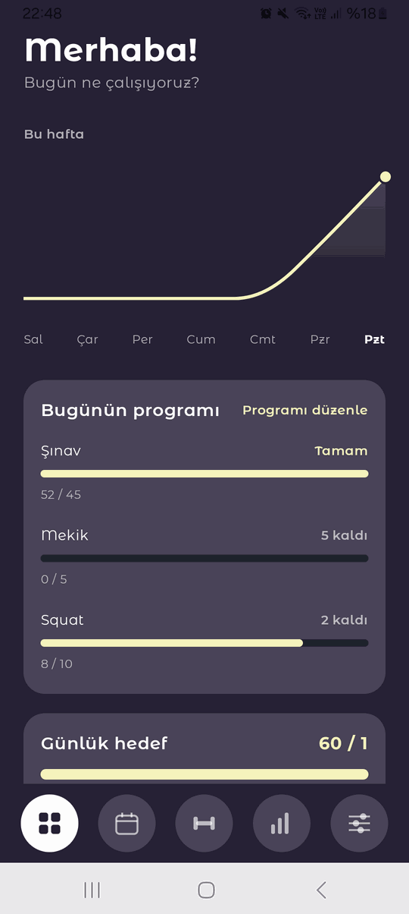
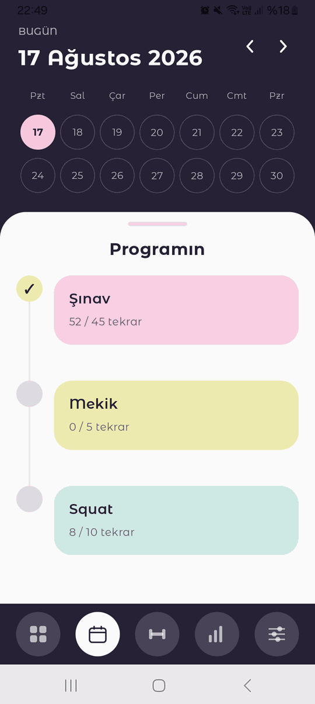
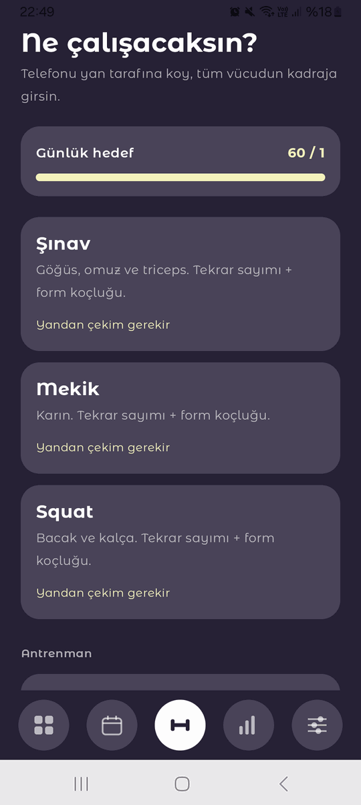
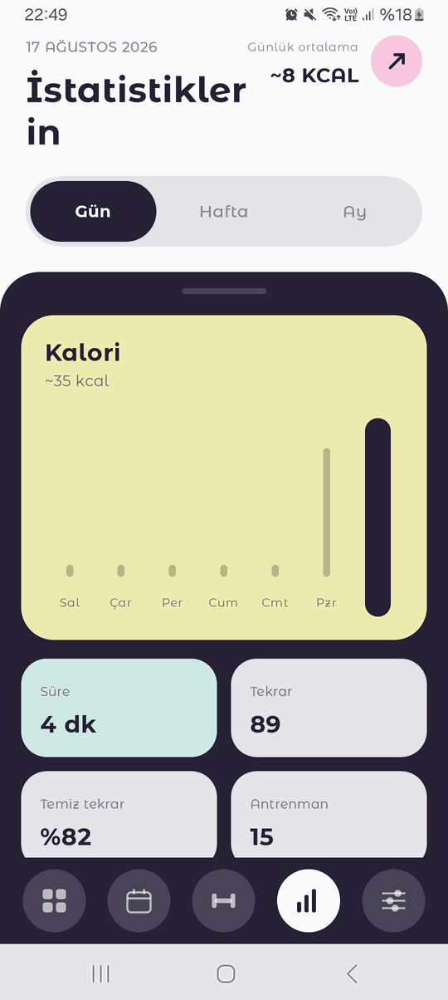
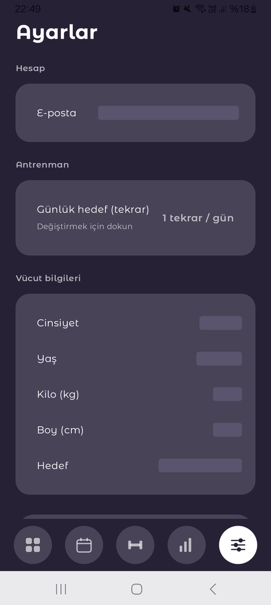

# AI Fitness Coach

Kamerayla egzersiz analizi yapan, tekrar sayan, form hatası tespit eden ve gerçek
zamanlı Türkçe sesli koçluk veren bir sistem. Android uygulaması + olay güdümlü
mikroservis arka ucu.

**Desteklenen egzersizler:** şınav, mekik, squat.

---

## Ne yapıyor

Telefonu yere koyuyorsun, kamera seni görüyor, uygulama:

1. **Kurulumu doğruluyor** — açı, mesafe, ışık, sabitlik uygun değilse *saymayı reddediyor*
2. **Tekrar sayıyor** — deterministik state machine + histerezis (asla ML değil)
3. **Form hatası buluyor** — kural motoru + eğitilmiş faz sınıflandırıcı
4. **Sesli uyarıyor** — "kalçan düşüyor", tekrar başına en fazla bir uyarı
5. **Kaydı sunucuya yazıyor** — geçmiş, istatistik, kalori, program takibi

Analizin tamamı **cihazda** çalışıyor. Görüntü ve landmark verisi telefondan
**hiç çıkmıyor**; sunucuya yalnızca türetilmiş sayılar gidiyor (tekrar sayısı, süre,
hareket aralığı, hata *adı*). Gerekçe: ADR 0002.

---

## Ekranlar

<p>
  
  
  
  
  
</p>

Soldan sağa: **Anasayfa** (haftalık grafik + günün programı), **Takvim** (gün şeridi),
**Antremanlar** (egzersiz seçimi), **İstatistik** (kalori, tekrar, temiz tekrar oranı),
**Ayarlar** (kişisel değerler görüntüde sansürlendi).

Programdaki ilerleme çubukları sunucuda **saklanmıyor**, her istekte antrenman
kayıtlarından hesaplanıyor — gerekçesi ADR 0012'de.

---

## Depo yerleşimi

Proje üç klasöre yayılmış:

| Klasör | İçerik |
|---|---|
| `TrainerAsistant` | **Ana repo** — `docs/` (ADR + CV spec), `services/` (backend), `.claude/` |
| `TrainerAsistantMobile` | Android uygulaması — `:app` + `:core` |
| `trainer_ann` | ML eğitimi — dataset, PyTorch eğitimi, TFLite dışa aktarımı |

`.claude/` (agent tanımları + skill'ler) **yalnızca ana repoda** ve tek doğruluk
kaynağı. `pose-math` skill'i Kotlin ile Python'ın aynı sonucu vermesini garanti
ediyor; kopyalanırsa tam da engellemek istediği ayrışma olur.

---

## Mimari

```
        Android (:app + :core)
        kamera → pose → feature → FSM → form kuralı → TTS
                          │
                          ▼  yalnızca türetilmiş sayılar
                   ┌─────────────┐
                   │ api-gateway │  JWT doğrular, X-User-Id yazar
                   └──────┬──────┘
        ┌─────────┬───────┼────────┬──────────┐
        ▼         ▼       ▼        ▼          ▼
      auth      user   workout   health   analytics
     auth_db  user_db workout_db health_db analytics_db
                        │                     ▲
                        └── outbox → Kafka ───┘
                              workout.session
```

**Database-per-service.** Hiçbir servis başkasının veritabanına dokunmuyor
(ADR 0005).

**Outbox pattern.** Antrenman kaydı ile olay *aynı transaction'da* yazılıyor; ayrı
bir relay onları Kafka'ya taşıyor. Commit ile publish arasında düşen bir süreç veri
kaybı bırakmıyor (ADR 0006).

**Idempotent consumer + replay.** Kafka en az bir kez teslim ediyor; tüketici
tekrarları yutuyor. `analytics_db` silinip olaylar sıfırdan oynatıldığında **aynı
sonuç** üretiliyor — doğrulama kaydı `docs/roadmap.md` Phase 11'de.

---

## Kilitlenmiş kararlar

Bunlar tartışılmış ve onaylanmış; değiştirmek yeni bir ADR gerektiriyor.

| Karar | ADR |
|---|---|
| Önce kural tabanlı, veri biriktikçe ML | 0001 |
| Tüm gerçek zamanlı analiz cihazda | 0002 |
| ML birimi kare değil **tekrar**; LSTM/Transformer yok | 0003 |
| Normalization: kalça merkezli + gövde uzunluğuyla ölçekleme | 0004 |
| 5 servis, database-per-service | 0005 |
| Kafka + outbox + idempotent consumer | 0006 |
| `:core` saf JVM — Android bağımlılığı yok | 0008 |
| Online-only depolama, tek kaynak PostgreSQL | 0009 |
| Faz sınıfları `START` / `PEAK` / `OTHER`, egzersiz başına ayrı model | 0011 |
| Günlük program: tamamlanma **saklanmaz, kayıtlardan türetilir** | 0012 |

### Tartışılmaz teknik kurallar

- **ML Kit `z` değeri kullanılmaz.** Metrik derinlik değil; yalnızca dataset'e loglanıyor.
- **`inFrameLikelihood < 0.5` olan landmark'a dayanan feature `null` döner.** Tahmin
  edilmez, varsayılan atanmaz — *yanlış ölçmektense ölçmemek doğrudur*.
- **Rep sayma asla ML değildir.** Deterministik state machine + histerezis.
- **Kamera açısı bir ürün kısıtıdır, ML problemi değildir.** Setup Validator kurulum
  uygun olmadan saymayı reddeder.
- **Eşikler mutlak değil, kişisel referansa göreli tanımlanır.**
- **Feature matematiği Kotlin ve Python'da birebir aynı sonucu vermelidir.**
- **Yeni egzersiz eklemek kod yazmak değil, spec yazmaktır.**

---

## Hızlı başlangıç

### Backend

```bash
cd services
cp .env.example .env
./infra/generate-keys.sh      # JWT için RSA çifti — depoya girmez
docker compose up --build
```

Ayrıntı: [`services/README.md`](services/README.md)

### Android

```bash
cd ../TrainerAsistantMobile
./gradlew :app:installDebug
```

Ayrıntı: `TrainerAsistantMobile/README.md`

---

## Durum

**Phase 11.6.** Çalışan bir bütün: 3 egzersiz, hibrit form analizi, sesli koçluk,
günlük program, istatistik, su/uyku takibi, 6 servis + Kafka.

| Faz | Ne | Durum |
|---|---|---|
| 0–3 | Mimari, Android iskelet, feature, şınav sayımı | ✅ |
| 4 | İkinci egzersiz (mekik) — sonradan squat da eklendi | ✅ |
| 5 | Gerçek zamanlı feedback + TTS | ✅ |
| 6–8 | Veri toplama → dataset → faz sınıflandırıcı | ✅ |
| 9 | Hibrit form analizi | ✅ |
| 10 | Mikroservisler | ✅ |
| 11 | Event-driven (Kafka + outbox + replay) | ✅ |
| 11.5 | `health-service` (su + uyku) | ✅ |
| 11.6 | Backend testleri, dinlenme sayacı, tekrar oynatıcı | ✅ |
| 12 | Observability (OpenTelemetry, Prometheus) | ⬜ |
| 13 | Kubernetes + CI/CD | ⬜ |

Tam faz tablosu ve çıkış kriterleri: `docs/roadmap.md`

### Bilinen açıklar

Dürüstlük gereği kayıtlı:

- **Form eşiklerinin hiçbiri ölçülmedi.** Üçü de `tuning_status: initial`, yani
  spec'ten alınan tahmin. Ölçüm aracı hazır ve kayıt bekliyor:
  `docs/computer-vision/threshold-measurement.md`
- **Squat modelinin üstünlüğü kanıtlanamadı.** ANN 1.0000 vs baseline 1.0000, fark
  +0.0000 — ama test kümesi 3 kayıt, yani karşılaştırma **sonuçsuz**, "model işe
  yaramıyor" değil. Şınavda fark +%20.1'di.
- **Uygulama öldürülürse antrenman kaybolur.** ADR 0009'un bilinen bedeli; çevrimdışı
  kuyruk kapsam dışı bırakıldı.
- **`auth-service` fanout'u hâlâ HTTP.** Hesap silme Kafka'ya taşınmadı.
- **Dataset lisansı.** Squat kayıtlarının bir kısmında stok video filigranı var.

---

## Dokümantasyon

> **Bu depoda yok.** Ayrıntılı dokümantasyon bilinçli olarak depo dışında tutuluyor;
> yukarıdaki kararların **gerekçeleri** orada duruyor. Bu README onların özeti.

| Ne | Nerede (yerel) |
|---|---|
| Mimari kararlar (12 ADR) | `docs/architecture/adr/` |
| Sistem genel bakış | `docs/architecture/overview.md` |
| Egzersiz spec'leri | `docs/computer-vision/{pushup,situp,squat}.md` |
| Feature tanımları | `docs/computer-vision/feature-spec.md` |
| Eşik ölçüm yöntemi | `docs/computer-vision/threshold-measurement.md` |
| Faz planı + çıkış kriterleri | `docs/roadmap.md` |
| Ürün backlog'u + rakip analizi | `docs/product/backlog.md` |
| Teknik sözleşmeler | `.claude/skills/` |

Testler de depoda değil — kod tabanında 73 backend entegrasyon testi ve `:core`
için 30 test dosyası var, yerelde koşuyorlar.

---

## Dil

Kod, tanımlayıcılar ve commit mesajları **İngilizce**; dokümantasyon ve tartışma
**Türkçe**; kullanıcıya gösterilen metinler TR birincil, EN ikincil.
